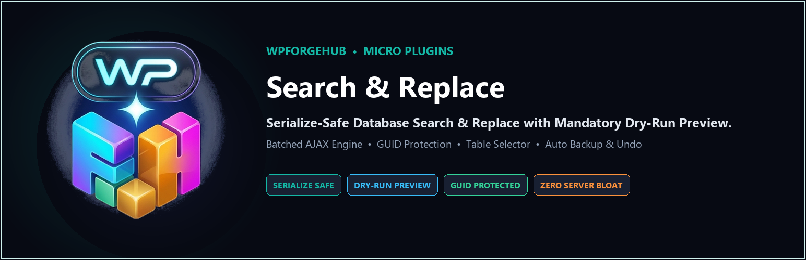
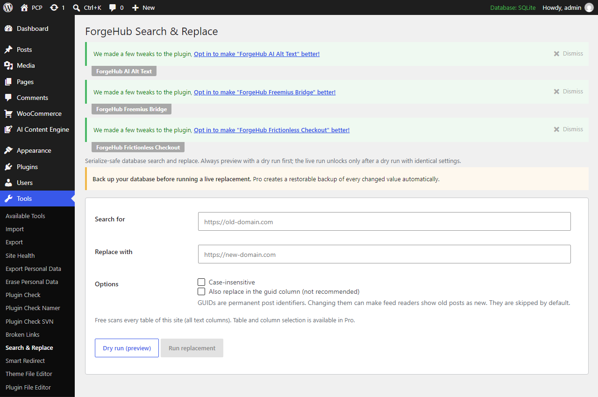

# ForgeHub Search & Replace

Serialize-safe database search and replace with a mandatory dry-run preview and batched AJAX processing.

## Free vs Pro

| Feature | Free | Pro |
| :--- | :---: | :---: |
| Serialize-safe replace | ✅ | ✅ |
| Mandatory dry-run preview | ✅ | ✅ |
| Batched AJAX processing | ✅ | ✅ |
| guid protection | ✅ | ✅ |
| Table and column selection | ❌ | ✅ |
| Automatic backup and one-click undo | ❌ | ✅ |

## Install

Upload the plugin and open **Tools → Search & Replace**.

Links: [WPForgeHub](https://wpforgehub.com) · [GitHub](https://github.com/WpForgeHub)

---

## 📸 Admin Preview

  

---

## 🔗 Links & Resources

- **Plugin Page:** [https://wpforgehub.com/product/search-replace/](https://wpforgehub.com/product/search-replace/)
- **Documentation & Help:** [wpforgehub.com/docs](https://wpforgehub.com/docs/)
- **More Free WordPress Plugins:** [wpforgehub.com](https://wpforgehub.com/#products)
